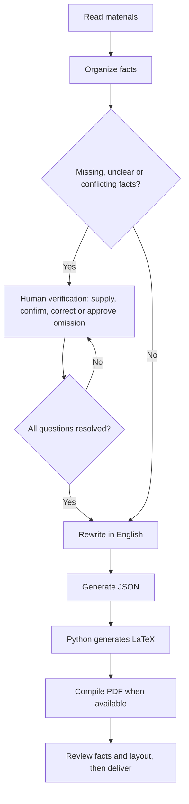

# English Resume Skill Agent

[中文](README.md) | **English**

**Turn your experiences and existing materials into a consistently formatted, editable English resume.**

For CS and related master's applications, with research and professional profiles. AI organizes and rewrites supplied facts; Python generates LaTeX/PDF. Missing, unclear or contradictory facts require human verification.

## Quick start

Download and extract the repository. Rename the complete folder to `english-resume-skill-agent` and install it in a host that supports Skills. For Codex, use `~/.agents/skills/` or your project's `.agents/skills/`. On Windows, use `<user profile>/.agents/skills/`.

Check the path: `.agents/skills/english-resume-skill-agent/SKILL.md`. Keep the entire folder, not just SKILL.md. Attach your materials and send:

```text
$english-resume-skill-agent
Create an English resume for my CS master's applications from my materials.
Use the research (or professional) profile and preserve the fixed layout.
Ask me to verify missing or unclear facts before final delivery.
```

Research profiles emphasize methods, experiments and academic preparation. Professional profiles prioritize employment and technical contributions.

## Workflow



Unresolved facts permit only a labelled draft. Python validates structure; it cannot verify factual truth.

## Requirements

- Skill workflow: an AI host with Skill support and file execution.
- LaTeX output: [Python](https://www.python.org/downloads/), with no pip packages required.
- PDF output: a LaTeX compiler, such as [MacTeX](https://tug.org/mactex/), [MiKTeX](https://miktex.org/download) or [TeX Live](https://tug.org/texlive/).

If you already have JSON, run this from the repository root:

```bash
python3 scripts/generate_resume.py examples/01-research-ai.json -o generated/resume.tex --pdf
```

Omit `--pdf` without a compiler. On Windows, `py -3` can replace `python3`. See the [field reference](references/schema.md) and [demo guide](examples/DEMO-GUIDE.md) for details.

## Four examples

These two-page fictional examples demonstrate different applicant backgrounds. People, experiences and numbers are invented for teaching, not real application material. example.com links are demonstrations.

### Research: machine learning and reliable AI

Experiments, data quality, calibration and reproducibility.

[](docs/images/01-research-ai.png)

[PDF](examples/01-research-ai.pdf) · [JSON](examples/01-research-ai.json)

### Research: mathematics to scientific computing

Numerical methods, optimization, teaching and interdisciplinary preparation.

[](docs/images/02-research-scientific-computing.png)

[PDF](examples/02-research-scientific-computing.pdf) · [JSON](examples/02-research-scientific-computing.json)

### Professional: backend and distributed systems

Order services, database performance, queues and failure testing.

[](docs/images/03-professional-backend.png)

[PDF](examples/03-professional-backend.pdf) · [JSON](examples/03-professional-backend.json)

### Professional: mobile, HCI and accessibility

Mobile performance, offline sync, user research and accessibility.

[](docs/images/04-professional-mobile.png)

[PDF](examples/04-professional-mobile.pdf) · [JSON](examples/04-professional-mobile.json)

## License

[Apache-2.0](LICENSE). Issues and improvements are welcome.
