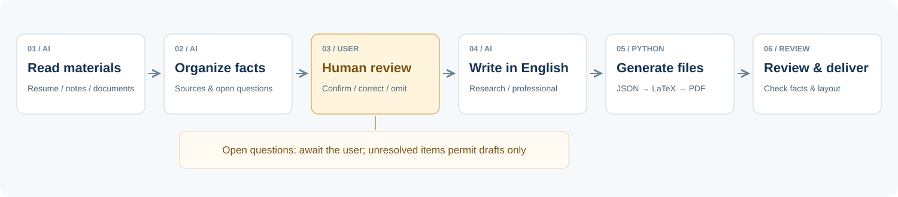
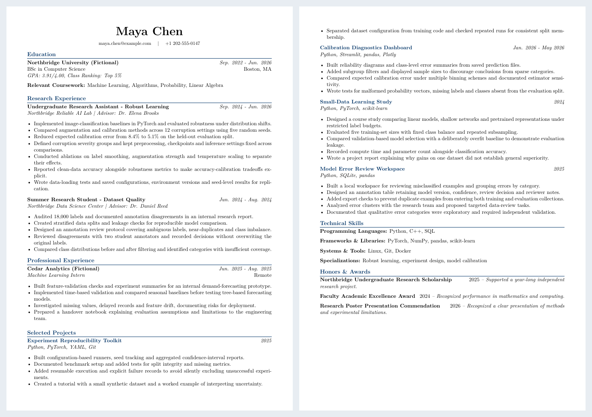
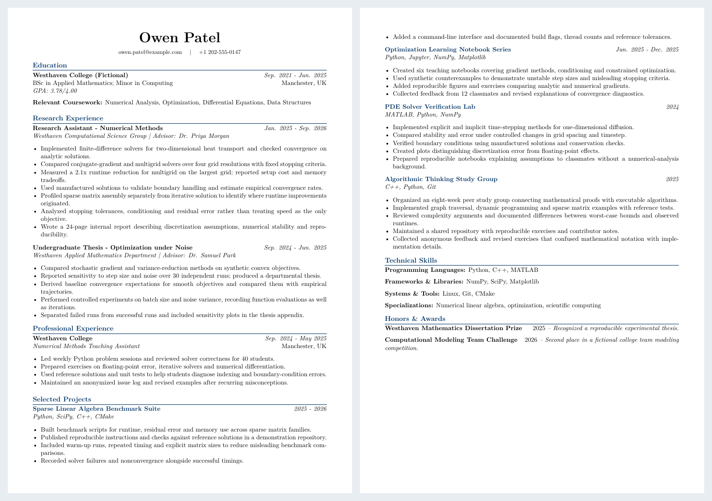
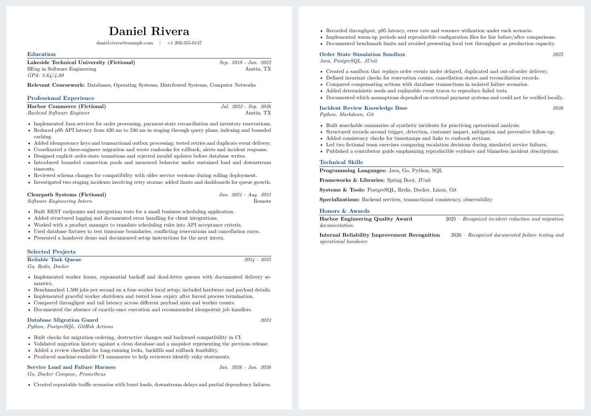
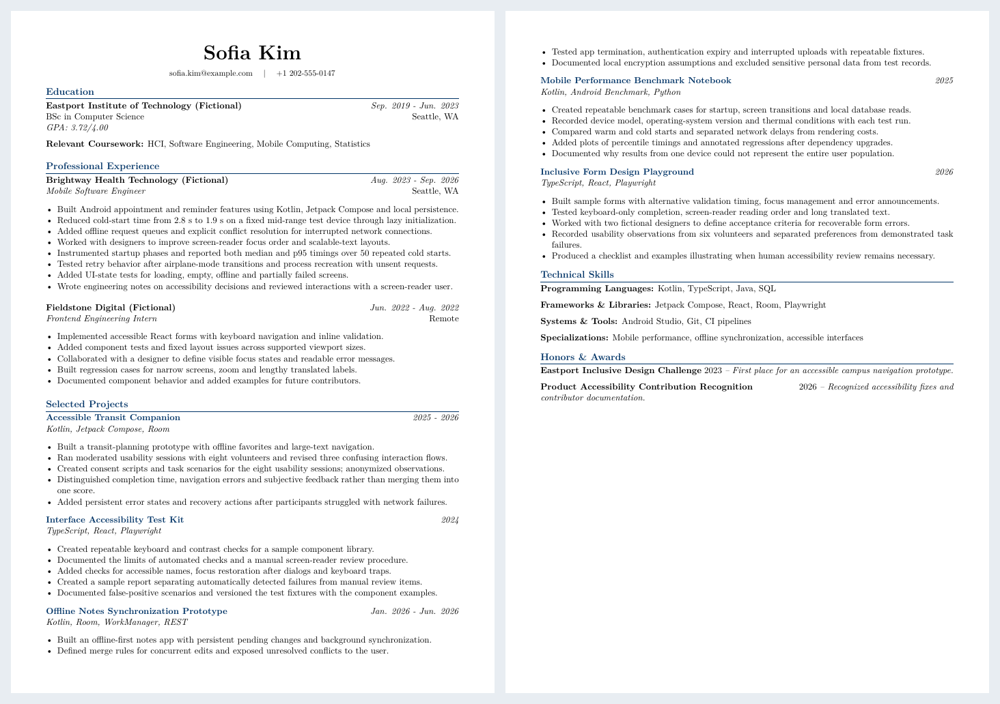

<p align="center">
  
</p>

<p align="center">
  <strong>English</strong> · <a href="README.zh-CN.md">中文</a>
</p>

<p align="center">
  <strong>Your experiences, turned into a clear and accurate English resume. No manual formatting needed! Write freely! Edit freely!</strong><br />
  For degree's applications and job hunting. Editable JSON, LaTeX and PDF output.
</p>

<p align="center">
  <strong>This resume generator has helped many people receive OFFERs when applying to multiple universities, including UIUC, Georgia Tech, UT Austin, University of Wisconsin–Madison, University of Leeds, University of Southampton, University of Liverpool, UPenn, University of Sydney, and many others! Hope everyone gets into their dream school!</strong>
</p>


<p align="center">
  <a href="#quick-start">Get started</a> · <a href="#workflow">Workflow</a> · <a href="#four-examples">Explore examples</a> · <a href="LICENSE">Apache-2.0</a>
</p>

## Quick start

**Ask your Agent to install it with one sentence:**

```text
Install https://github.com/AlanSong2077/english-resume-skill.git as a user-level Skill for this agent, preserve the complete folder, and verify that english-resume-skill is discoverable before showing me how to invoke it.
```

Your Agent needs network access, file-writing permissions and a host that supports Skills. It should use that host's documented install directory, keep existing installations safe, and request required permissions. This installs the Skill; Python and a LaTeX compiler are separate output requirements.

<details>
<summary>Prefer to install manually?</summary>

Download and extract the repository. Rename the complete folder to `english-resume-skill` and install it in a host that supports Skills. For Codex, use `~/.agents/skills/` or your project's `.agents/skills/`. On Windows, use `<user profile>/.agents/skills/`.

Check the path: `.agents/skills/english-resume-skill/SKILL.md`. Keep the entire folder, not just SKILL.md. Reopen the host if needed and check its Skill selector for `english-resume-skill`.

</details>

**Once installed, attach your materials and send:**

```text
$english-resume-skill
Create an English resume for my CS master's applications from my materials.
Use the research (or professional) profile and preserve the fixed layout.
Ask me to verify missing or unclear facts before final delivery.
```

## Workflow



Unresolved facts permit only a labelled draft. Python validates structure; it cannot verify factual truth.

`agents/openai.yaml` contains Codex Skill display and invocation metadata, not an independent agent. This project is a Skill executed by your AI host.

## Requirements

- Skill workflow: an AI host with Skill support and file execution.
- LaTeX output: [Python](https://www.python.org/downloads/), with no pip packages required.
- PDF output: a LaTeX compiler, such as [MacTeX](https://tug.org/mactex/), [MiKTeX](https://miktex.org/download) or [TeX Live](https://tug.org/texlive/).

If you already have JSON, run this from the repository root:

```bash
python3 scripts/generate_resume.py examples/01-research-ai.json -o generated/resume.tex --pdf
```

Omit `--pdf` without a compiler. On Windows, `py -3` can replace `python3`. See the [field reference](references/schema.md) and [demo guide](examples/DEMO-GUIDE.md) for details.

## Cases

People, experiences and numbers are invented.

<table>
<tr>
<td width="50%" valign="top">
<h3>Machine learning &amp; reliable AI</h3>
<p>Research · calibration, experiments, reproducibility</p>
<a href="docs/images/01-research-ai.png"></a>
<p><a href="examples/01-research-ai.pdf">PDF</a> · <a href="examples/01-research-ai.json">JSON</a></p>
</td>
<td width="50%" valign="top">
<h3>Mathematics to scientific computing</h3>
<p>Research · numerical methods and optimization</p>
<a href="docs/images/02-research-scientific-computing.png"></a>
<p><a href="examples/02-research-scientific-computing.pdf">PDF</a> · <a href="examples/02-research-scientific-computing.json">JSON</a></p>
</td>
</tr>
<tr>
<td width="50%" valign="top">
<h3>Backend &amp; distributed systems</h3>
<p>Professional · services, databases, reliability</p>
<a href="docs/images/03-professional-backend.png"></a>
<p><a href="examples/03-professional-backend.pdf">PDF</a> · <a href="examples/03-professional-backend.json">JSON</a></p>
</td>
<td width="50%" valign="top">
<h3>Mobile, HCI &amp; accessibility</h3>
<p>Professional · performance, sync, usability</p>
<a href="docs/images/04-professional-mobile.png"></a>
<p><a href="examples/04-professional-mobile.pdf">PDF</a> · <a href="examples/04-professional-mobile.json">JSON</a></p>
</td>
</tr>
</table>

## License

[Apache-2.0](LICENSE). Issues and improvements are welcome.
