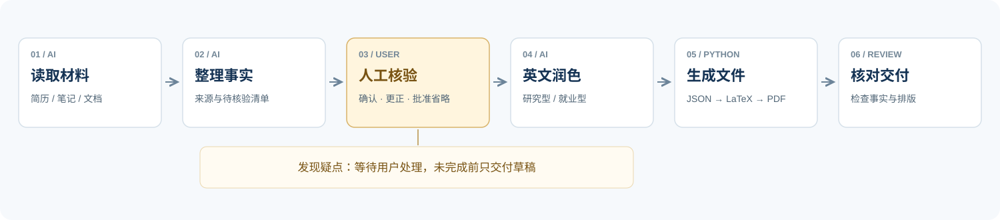

<p align="center">
  
</p>

<p align="center">
  <strong>中文</strong> · <a href="README.en.md">English</a>
</p>

<p align="center">
  <strong>将你的经历，写成清晰、可信、排版统一的英文简历。</strong><br />
  用于 CS 及相关专业硕士申请，输出可编辑的 JSON、LaTeX 和 PDF。
</p>

<p align="center">
  <a href="#快速使用">开始使用</a> · <a href="#使用流程">工作流程</a> · <a href="#四套成果展示">查看案例</a> · <a href="LICENSE">Apache-2.0</a>
</p>


## 快速使用

下载并解压仓库，将整个文件夹命名为 `english-resume-skill-agent`，安装到支持 Skill 的工具中。Codex 用户可放到 `~/.agents/skills/`，或项目的 `.agents/skills/` 下；Windows 用户目录为 `<user profile>/.agents/skills/`。

确认目录为 `.agents/skills/english-resume-skill-agent/SKILL.md`，不要只复制 SKILL.md。然后附上自己的材料，输入：

```text
$english-resume-skill-agent
请根据我的材料生成英文 CS 硕士申请简历。
采用研究型（或就业型）顺序，保持制式排版。
不清楚或缺失的信息必须先让我人工核验。
```

## 使用流程



人工核验完成前，只能交付待核验草稿；Python 检查结构，不能代替事实确认。

## 必要环境

- 使用 Skill：需要支持 Skill 和文件执行的 AI 工具。
- 生成 LaTeX：需要 [Python](https://www.python.org/downloads/)，无需 pip 包。
- 生成 PDF：还需 LaTeX 编译器，例如 [MacTeX](https://tug.org/mactex/)、[MiKTeX](https://miktex.org/download) 或 [TeX Live](https://tug.org/texlive/)。

已有 JSON 时，也可以在仓库根目录直接运行：

```bash
python3 scripts/generate_resume.py examples/01-research-ai.json -o generated/resume.tex --pdf
```

没有编译器时去掉 `--pdf`；Windows 可用 `py -3` 替代 `python3`。更多字段与复现方法见 [字段说明](references/schema.md) 和 [DEMO 指南](examples/DEMO-GUIDE.md)。

## 案例

以下均为两页人物、经历及数字均为虚构。

<table>
<tr>
<td width="50%" valign="top">
<h3>机器学习与可靠 AI</h3>
<p>研究型 · 校准、实验与复现</p>
<a href="docs/images/01-research-ai.png"></a>
<p><a href="examples/01-research-ai.pdf">PDF</a> · <a href="examples/01-research-ai.json">JSON</a></p>
</td>
<td width="50%" valign="top">
<h3>数学转科学计算</h3>
<p>研究型 · 数值方法与优化</p>
<a href="docs/images/02-research-scientific-computing.png"></a>
<p><a href="examples/02-research-scientific-computing.pdf">PDF</a> · <a href="examples/02-research-scientific-computing.json">JSON</a></p>
</td>
</tr>
<tr>
<td width="50%" valign="top">
<h3>后端与分布式系统</h3>
<p>就业型 · 服务、数据库与可靠性</p>
<a href="docs/images/03-professional-backend.png"></a>
<p><a href="examples/03-professional-backend.pdf">PDF</a> · <a href="examples/03-professional-backend.json">JSON</a></p>
</td>
<td width="50%" valign="top">
<h3>移动端、HCI 与无障碍</h3>
<p>就业型 · 性能、同步与用户体验</p>
<a href="docs/images/04-professional-mobile.png"></a>
<p><a href="examples/04-professional-mobile.pdf">PDF</a> · <a href="examples/04-professional-mobile.json">JSON</a></p>
</td>
</tr>
</table>

## 许可

采用 [Apache-2.0](LICENSE)。欢迎提交 Issue 或改进建议。
