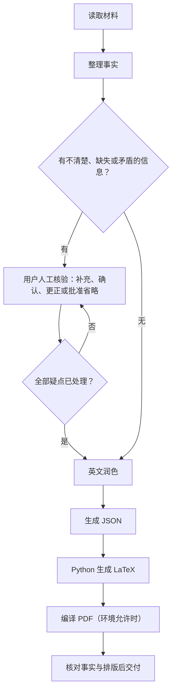

# English Resume Skill Agent

**中文** | [English](README.en.md)

**根据你的经历和现有材料，生成排版统一、可编辑的英文简历。**

适用于 CS 及相关专业硕士申请，支持研究型和就业型简历。AI 整理与润色内容，Python 生成 LaTeX/PDF；不清楚、缺失或矛盾的信息必须先由用户人工核验。

## 快速使用

下载并解压仓库，将整个文件夹命名为 `english-resume-skill-agent`，安装到支持 Skill 的工具中。Codex 用户可放到 `~/.agents/skills/`，或项目的 `.agents/skills/` 下；Windows 用户目录为 `<user profile>/.agents/skills/`。

确认目录为 `.agents/skills/english-resume-skill-agent/SKILL.md`，不要只复制 SKILL.md。然后附上自己的材料，输入：

```text
$english-resume-skill-agent
请根据我的材料生成英文 CS 硕士申请简历。
采用研究型（或就业型）顺序，保持制式排版。
不清楚或缺失的信息必须先让我人工核验。
```

研究型突出研究方法、实验和学术背景；就业型优先展示工作经历与技术贡献。

## 使用流程



人工核验完成前，只能交付待核验草稿；Python 检查结构，不能代替事实确认。

## 必要环境

- 使用 Skill：需要支持 Skill 和文件执行的 AI 工具。
- 生成 LaTeX：需要 [Python](https://www.python.org/downloads/)，无需 pip 包。
- 生成 PDF：还需 LaTeX 编译器，例如 [MacTeX](https://tug.org/mactex/)、[MiKTeX](https://miktex.org/download) 或 [TeX Live](https://tug.org/texlive/)。

已有 JSON 时，也可以在仓库根目录直接运行：

```bash
python3 scripts/generate_resume.py examples/01-research-ai.json -o generated/resume.tex --pdf
```

没有编译器时去掉 `--pdf`；Windows 可用 `py -3` 替代 `python3`。更多字段与复现方法见 [字段说明](references/schema.md) 和 [DEMO 指南](examples/DEMO-GUIDE.md)。

## 四套成果展示

以下为两页虚构教学案例，展示不同背景的写法。人物、经历和数字均为虚构，不能作为真实申请材料；example.com 链接仅作演示。

### 研究型：机器学习与可靠 AI

研究实验、数据质量、模型校准和复现。

[](docs/images/01-research-ai.png)

[PDF](examples/01-research-ai.pdf) · [JSON](examples/01-research-ai.json)

### 研究型：数学转科学计算

数值方法、优化研究、助教经历和跨专业准备。

[](docs/images/02-research-scientific-computing.png)

[PDF](examples/02-research-scientific-computing.pdf) · [JSON](examples/02-research-scientific-computing.json)

### 就业型：后端与分布式系统

订单系统、数据库优化、任务队列和故障测试。

[](docs/images/03-professional-backend.png)

[PDF](examples/03-professional-backend.pdf) · [JSON](examples/03-professional-backend.json)

### 就业型：移动端、HCI 与无障碍

移动端性能、离线同步、用户研究与无障碍设计。

[](docs/images/04-professional-mobile.png)

[PDF](examples/04-professional-mobile.pdf) · [JSON](examples/04-professional-mobile.json)

## 许可

采用 [Apache-2.0](LICENSE)。欢迎提交 Issue 或改进建议。
